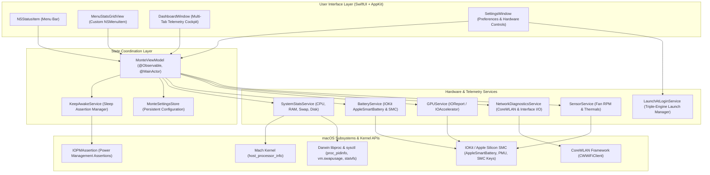

# Mont-E Architecture & Technical Specifications

> **Notice:** The canonical, fully illustrated architectural documentation with sequence diagrams and subsystem deep dives is maintained in [`docs/ARCHITECTURE.md`](docs/ARCHITECTURE.md).

---

## Architecture Summary

Mont-E is built in pure **Swift 6** using a clean, layered architecture separating user interface presentation, observable domain state, specialized hardware drivers, and low-level Darwin/Mach kernel interfaces:

For full details on:
* **Telemetry Sampling & Polling Lifecycles**
* **Battery SMC Management & Direct AC Pass-Through**
* **Triple-Engine Launch at Login Architecture**
* **Subsystem Implementations (P/E-Cores, GPU, Network, Keep-Awake)**
* **Swift 6 Strict Concurrency & Performance Guarantees**

Please read the complete document at **[`docs/ARCHITECTURE.md`](docs/ARCHITECTURE.md)**.
