# Mont-E: Complete Requirements, Architecture & Implementation Specification

> **Target Audience:** AI Agents & Systems Engineers  
> **Purpose:** Standalone, single-file master specification for implementing **Mont-E** from scratch on macOS without external dependencies.

---

## 1. Executive Summary & Product Vision

**Mont-E** is an ultra-lightweight, native macOS menu bar utility, hardware telemetry cockpit, and battery preservation tool engineered specifically for software engineers, devops practitioners, and power users.

### Core Value Propositions
1. **0.0% Idle CPU Overhead & Sub-50MB Memory Footprint:** Unlike Electron monitors or legacy apps running 30–60 FPS animation loops, Mont-E uses static vector rendering for its menu bar status dot, suspends timers when dropdown menus are closed, and queries low-level kernel APIs synchronously in under 0.1ms.
2. **Apple Silicon Hardware Telemetry:** Directly surfaces Performance (P-Core) vs Efficiency (E-Core) cluster scheduling, Apple Silicon GPU/Neural Engine load via `IOReport`/`IOAccelerator`, fan tachometer RPM, and multi-volume APFS/external drive storage metrics.
3. **Hardware Battery Preservation (SMC Limiter & Direct AC Pass-Through):** Enforces hardware charge thresholds (e.g., 70% or 80%) via Apple Silicon System Management Controller (SMC) register control, running logic board power directly from the wall adapter with zero battery micro-cycling. Includes on-demand PMU lifetime thermal diagnostics.
4. **Developer-Smart Keep-Awake Engine:** Granular macOS power management sleep assertions (`IOPMAssertionCreateWithName` for Display vs System Idle sleep) with automatic compilation detection (`xcodebuild`, `gradle`, `docker`, `swift-frontend`, `cargo`, `python`) and battery/thermal safety fail-safes.
5. **SSD Swap Wear Defense & 1-Click Dev Cleaners:** Monitors swap thrashing (`sysctl vm.swapusage`) to protect soldered Apple Silicon NAND flash, stops orphan Gradle daemons, purges inactive file caches, and cleans heavy developer build products (Xcode `DerivedData`, AI Agent brain transcripts, Gradle caches, CocoaPods).

---

## 2. Technical Stack & Environment Constraints

| Parameter | Specification |
| :--- | :--- |
| **Operating System** | macOS 14.0 (Sonoma) or newer (Sequoia compatible) |
| **Language & Toolchain** | Pure **Swift 6** (Swift 5.9+ tools version) |
| **Concurrency Model** | Strict Concurrency (`@MainActor` for UI/ViewModel, `Sendable` types, thread-safe actors for shared mutable state) |
| **UI Frameworks** | **SwiftUI** embedded within **AppKit** (`NSStatusItem`, `NSMenu`, `NSHostingView`, `NSWindowController`) |
| **External Dependencies** | **Zero (0) external third-party dependencies**. Only macOS native system frameworks and Mach/Darwin kernel headers |
| **Application Mode** | Native Agent Accessory (`LSUIElement = YES` in `Info.plist`, no Dock icon) |
| **System Frameworks** | `AppKit`, `SwiftUI`, `IOKit`, `CoreWLAN`, `IOBluetooth`, `ServiceManagement`, `UserNotifications`, `CoreAudio`, `SystemConfiguration` |
| **Kernel / C APIs** | Mach Kernel (`host_processor_info`, `vm_statistics64`), Darwin `libproc` (`proc_pidinfo`, `proc_listpids`), `sysctl`, `statvfs` |

---

## 3. Architecture & Design Principles

### 3.1 Strict Layered Architecture

```mermaid
graph TD
    subgraph UI ["User Interface Layer (SwiftUI + AppKit)"]
        MenuBar["NSStatusItem + 3D Static LED Dot"]
        HUD["MenuStatsGridView (Custom NSMenuItem hosting SwiftUI)"]
        Dashboard["DashboardWindowController + DashboardView (6 Tabs)"]
        Settings["SettingsWindowController + SettingsView (6 Tabs)"]
        Investigator["ProcessInvestigatorSheet (libproc Process Explorer)"]
    end

    subgraph State ["State Management Layer"]
        VM["MonteViewModel (@Observable, @MainActor)"]
        Store["MonteSettingsStore (Persistent UserDefaults State)"]
        KeepAwakeMgr["KeepAwakeService (Sleep Assertion Manager)"]
    end

    subgraph Services ["Telemetry & System Drivers Layer"]
        Stats["SystemStatsService (Mach host_processor_info, vm_statistics64, sysctl)"]
        Battery["BatteryService (IOKit AppleSmartBattery, SMC Limiter, PMU)"]
        GPU["GPUService (IOReport / IOAccelerator PerformanceStatistics)"]
        Net["NetworkDiagnosticsService (CoreWLAN CWWiFiClient, getifaddrs delta)"]
        Sensor["SensorService (AppleSMC Fan Tachometer & Thermal State)"]
        Vol["StorageVolumeService (FileManager mounted volumes & statvfs)"]
        Clean["MemoryOptimizerService (Purge & Developer Cache Cleaners)"]
        BT["BluetoothBatteryService (IOBluetooth Connected Peripherals)"]
        Login["LaunchAtLoginService (Triple-Engine Redundancy)"]
        Watchdog["WatchdogAlertService (UNUserNotificationCenter Monitor)"]
        Shell["ShellService (Process + Pipe isolation)"]
    end

    MenuBar --> VM
    HUD --> VM
    Dashboard --> VM
    Settings --> VM
    Investigator --> VM

    VM --> Store
    VM --> KeepAwakeMgr
    VM --> Stats
    VM --> Battery
    VM --> GPU
    VM --> Net
    VM --> Sensor
    VM --> Vol
    VM --> Clean
    VM --> BT
    VM --> Watchdog
    Settings --> Login
    Stats --> Shell
    Battery --> Shell
```


### 3.2 Concurrency & Execution Guarantees
1. **Unidirectional State Flow:** UI is driven entirely by `@Observable @MainActor final class MonteViewModel`.
2. **Sub-0.1ms Fast-Path Telemetry vs Slow-Path Background Tasks:**
   - **Fast-Path (every 2.5s):** Mach CPU loads, Mach RAM statistics, `sysctl` swap memory, IOKit power source description, IOAccelerator GPU load, `getifaddrs` bandwidth counters. All polled synchronously on background utility queues without subprocess spawning.
   - **Slow-Path (every 30s or on-demand):** APFS directory traversal for Xcode `DerivedData`, AI Agent brain transcripts, Gradle caches, NVMe SMART wear health, and PMU lifetime thermal analytics.
3. **No Shell Concatenation / Command Injection:**
   - Whenever executing external CLI helpers (such as the `battery` SMC tool or `/usr/sbin/purge`), use Foundation `Process` and `Pipe` with discrete argument arrays (`[String]`). Never invoke `/bin/sh -c` or `system()`.
4. **Triple-Engine Launch at Login Redundancy:**
   - Engine 1: AppleScript System Events Login Item (registered in macOS System Settings -> General -> Login Items).
   - Engine 2: User LaunchAgent plist (`~/Library/LaunchAgents/com.digithreads.monte.plist`) running `/usr/bin/open -a /Applications/Monte.app`.
   - Engine 3: `SMAppService.mainApp` (macOS 13+ ServiceManagement standard).

---

## 4. Functional Requirements Catalog

### 4.1 Menu Bar & Status Item (NSStatusItem)
* **Status Item Rendering:** Variable-length status item (`NSStatusBar.system.statusItem(withLength: NSStatusItem.variableLength)`).
* **Static 3D LED Dot Indicator:**
  - Zero timer wakeups, static vector `NSImage` drawn via `NSGraphicsContext`.
  - 3 visual layers: Ambient glow border, 3D spherical dome with radial shading, specular glass lens highlight.
  - Dynamically colored by `SystemHealthLevel`:
    - `Optimal` (Emerald `#34D399`)
    - `Good` (Mint `#4ADE80`)
    - `Fair` (Amber `#FBBF24`)
    - `Strained` (Neon Tangerine `#FB923C`)
    - `Critical` (Ruby `#EF4444`)
* **Dynamic Menu Bar Tokens (User-Configurable in Settings):**
  - Keep-Awake indicator (`☕` when active)
  - RAM display (choice of percentage `68%` or absolute gigabytes `16.3G`)
  - Apple Silicon GPU utilization (`GPU 12%`)
  - CPU usage (`CPU 24%`)
  - SSD Swap footprint (`Swp 1.2G`)
  - Thermal condition emoji and label (`🟢 Nominal`, `🔥 Serious`)
  - Battery charge level & charging status (`⚡80%`, `🔋76%`)
* **Global Hotkey:** `Option + Command + K` (`⌥⌘K`) toggles Keep-Awake state globally from any application.
* **Standard Keyboard Shortcuts:**
  - `⌘⇧M`: Open Dashboard Window
  - `⌘P`: Open Process Investigator / RAM Inspector
  - `⌘R`: Force Refresh all hardware metrics
  - `⌘,`: Open Settings / Preferences Window
  - `⌘W`: Close active window
  - `⌘Q`: Terminate Mont-E

---

### 4.2 Interactive Dropdown HUD (MenuStatsGridView)
* Rendered as a custom `NSMenuItem` hosting a SwiftUI view via `NSHostingView`.
* **Responsive HUD Sizing Modes:**
  - **Small:** Width 260px (List) / 304px (Grid), Tile Height 48px, compact typography.
  - **Medium (Default):** Width 285px (List) / 332px (Grid), Tile Height 52px.
  - **Large:** Width 305px (List) / 356px (Grid), Tile Height 56px.
* **HUD Layout Modes:**
  - **2-Column Metric Grid:** 2 tiles per row (CPU, RAM, GPU, Swap, Battery, Storage, Top Process).
  - **Compact List:** Single vertical list for minimalist menu setups.
* **Smart Network Cockpit Header:**
  - High-density strip anchored at the top of the HUD.
  - Wi-Fi SSID, RSSI (dBm), link quality indicator (`Excellent`, `Good`, `Fair`, `Weak`).
  - Real-time download/upload differential bandwidth with fixed-width typography (`KB/s` / `MB/s`).
  - 10-minute rolling average calculated from a 240-sample ring buffer.
* **Contextual Quick Actions:**
  - 1-Click "Purge RAM & Daemons"
  - Quick toggle Keep-Awake presets
  - Quick set Battery Charge Limit (e.g. 70%, 80%, 100%)
  - Shortcut buttons to macOS native System Settings panes (Battery Settings, Storage Settings).

---

### 4.3 Hardware Telemetry Engine & Subsystems

#### 4.3.1 Apple Silicon CPU & Core Cluster Profiling
- Query Mach kernel `host_processor_info` with `PROCESSOR_CPU_LOAD_INFO`.
- Divide CPU logical cores into **Performance (P) Cores** and **Efficiency (E) Cores** based on topology.
- Compute differential utilization:
  $$\text{Utilization} = \frac{\Delta \text{User} + \Delta \text{System} + \Delta \text{Nice}}{\Delta \text{User} + \Delta \text{System} + \Delta \text{Nice} + \Delta \text{Idle}} \times 100\%$$
- Maintain a rolling FIFO sparkline history of 30 samples.

#### 4.3.2 Apple Silicon GPU & Neural Accelerator
- Query IOKit matching service `IOAccelerator`.
- Extract `PerformanceStatistics` dictionary:
  - `Device Utilization %` (active GPU engine percentage)
  - `Tiler Utilization %`
  - `Renderer Utilization %`
  - `Alloc system memory` / `in-use system memory` (allocated VRAM buffer size in MB)
- Subprocess overhead: 0.0ms (pure native IOKit registry traversal).

#### 4.3.3 Darwin RAM & SSD Swap Pressure
- **RAM Statistics:** Read Mach `vm_statistics64` via `host_statistics64(mach_host_self(), HOST_VM_INFO64)`.
  - Active, Wired, Compressed, and Free RAM memory.
  - Calculate used RAM: $\text{Used} = \text{Active} + \text{Wired} + \text{Compressed}$.
  - System total RAM via `sysctl hw.memsize`.
- **Swap Usage:** Query Darwin sysctl `vm.swapusage`.
  - Extract `xsu_total`, `xsu_avail`, `xsu_used`.
  - Assign `SwapRiskLevel`:
    - `SAFE`: Swap used $\le 2\text{ GB}$
    - `MODERATE`: $2\text{ GB} < \text{Swap used} \le 6\text{ GB}$
    - `CRITICAL`: Swap used $> 6\text{ GB}$ (warns developer of SSD wear).

#### 4.3.4 Active Cooling Fans & Thermals
- **Thermal Status:** Read Darwin process thermal notification levels:
  - `Nominal` (Cool, normal operation)
  - `Fair` (Warm, light load)
  - `Serious` (High heat, active fan spin-up)
  - `Critical` (Thermal throttling active)
- **Fan Tachometer:** Query `AppleSMC` service in IOKit:
  - Read fan count, current RPM, min RPM, max RPM, target RPM.
  - Support silent mode detection ($0\text{ RPM}$ on Apple Silicon MacBook Air and idle Pro models).

#### 4.3.5 NVMe Storage & Multi-Volume Drive Cockpit
- **APFS Free Space:** Query `statvfs` on root `/` mount.
- **IOBlockStorageDriver Statistics:** Read total bytes written/read and read/write I/O ops directly from IOKit `IOBlockStorageDriver` properties.
- **Multi-Volume Tracking:** Inspect `FileManager.default.mountedVolumeURLs` (filtering out hidden volumes):
  - Track total space, free space, internal vs external/removable flag, and filesystem type (APFS, HFS+, FAT/exFAT).

#### 4.3.6 Bluetooth Peripheral Battery Levels
- Query `IOBluetooth` and IOKit registry for connected peripherals.
- Extract battery percentages for:
  - AirPods (Left, Right, Case battery levels independently)
  - Magic Keyboard, Magic Mouse, Magic Trackpad
  - Third-party Bluetooth headsets & accessories

---

### 4.4 Battery Preservation & Apple Silicon SMC Charge Limiter
* **Problem Addressed:** Continuous charging to 100% capacity at elevated temperatures accelerates chemical degradation of lithium-ion cells.
* **Solution Architecture:**
  - Intercept charge management at the System Management Controller (SMC) level.
  - Set target threshold (presets: 70%, 80%, or custom percentage).
  - Enforce **Direct AC Pass-Through**: When battery percentage reaches target, the SMC cuts charge current to the battery cells while routing operating voltage directly from the USB-C / MagSafe power supply to the logic board.
  - Result: 0mA current flow into the battery, 0 heat generated from charging, 0 battery cycles accumulated.
* **CLI Limiter Tool Integration:**
  - Auto-discover installed battery CLI helpers (`/usr/local/bin/battery`, `/opt/homebrew/bin/battery`, `bctl`).
  - Maintain compatibility with `~/.battery/maintain.percentage`.
  - Provide a 1-click installer button in Settings (`curl -s https://raw.githubusercontent.com/... | bash`).
  - Support **Force Discharge**: When plugged in at 100%, force logic board to discharge down to 80% without disconnecting the charger, then engage pass-through.
* **Background Watchdog Guard:**
  - Periodic check (every 10s): If macOS power manager resets the SMC charge limit after system sleep or reboot, Mont-E immediately re-asserts the limit.
* **On-Demand PMU Lifetime Diagnostics:**
  - Query deep `AppleSmartBattery` Power Management Unit (PMU) `LifetimeData` dictionary:
    - Lifetime average battery temperature
    - Operating temperature extremes (maximum & minimum recorded °C)
    - Total operating hours and lifetime temperature sample count
    - Lifetime maximum pack voltage, maximum charge current, and maximum discharge current
  - *Zero overhead guarantee:* This query executes strictly on-demand when the user views the Battery Dashboard tab.

---

### 4.5 Smart Keep-Awake Engine

#### 4.5.1 Granular Sleep Assertions
Mont-E manages native Darwin power assertions via `IOPMAssertionCreateWithName`:
1. `kIOPMAssertionTypePreventUserIdleSystemSleep`: Prevents computer from sleeping while allowing display to turn off (ideal for background builds, downloads, render jobs).
2. `kIOPMAssertionTypePreventUserIdleDisplaySleep`: Prevents display from sleeping/dimming (ideal for presentations, monitoring).

#### 4.5.2 Modes & Presets
- **Indefinite:** Holds sleep assertion until manually stopped.
- **Timed Presets:** 15 minutes, 30 minutes, 1 hour, 2 hours, 4 hours, 8 hours, or custom duration.
- **Until Time:** Keeps awake until a specific wall clock time (e.g., 5:00 PM).

#### 4.5.3 Automated Developer Build Triggers
Monitors running processes using Darwin `proc_listpids` / `proc_pidinfo` and automatically engages sleep prevention when active build pipelines are running:
- **Xcode / Swift:** `xcodebuild`, `swift-frontend`
- **Gradle Daemons:** `gradle`, Gradle worker processes
- **Docker Containers:** `docker`, `com.docker.backend`
- **Rust / Cargo:** `cargo`, `rustc`
- **Python Tasks:** `python`, `python3`
- **Node.js:** `node`, build tools
- **C/C++:** `make`, `cmake`, `ninja`

#### 4.5.4 Environmental Triggers
- While connected to AC power adapter
- While external display / monitor is attached
- While connected to specific Wi-Fi network (SSID)
- While audio is playing (`CoreAudio` active output listener)
- While downloading (network download rate $> 500\text{ KB/s}$)
- Scheduled working hours (e.g. 09:00 to 18:00 on weekdays)

#### 4.5.5 Hardware Safety Guardrails
- **Low Battery Auto-Disengage:** Immediately releases all assertions if battery drops below a configurable threshold (e.g. 20%) while running on battery.
- **Thermal Safety Disengage:** Automatically releases assertions if the SoC reaches `Serious` or `Critical` thermal throttling levels.

---

### 4.6 Developer Storage Cleaners & RAM Purge

#### 4.6.1 1-Click Memory Purge (`MemoryOptimizerService`)
- Terminate idle Gradle worker daemons (`gradle --stop`).
- Invoke system cache drop (`/usr/sbin/purge`).
- Restart transient leaking cache services (`killall quicklookd`).
- Measure RAM usage before and after to display exact reclaimed memory (e.g. "Reclaimed 1.4 GB RAM").

#### 4.6.2 Developer Cache & Log Cleaners
Scans and safely reclaims disk space across high-churn developer directories:
1. **Google Antigravity Agent Brain:** `~/.gemini/antigravity/brain` (conversation transcripts, tool traces, subagent branches).
2. **Claude Desktop Logs & Cache:** `~/Library/Logs/Claude` (Electron traces, MCP stderr logs).
3. **Xcode DerivedData:** `~/Library/Developer/Xcode/DerivedData` (precompiled headers, intermediate build objects).
4. **Gradle Dependency Cache:** `~/.gradle/caches` (outdated remote Maven artifacts).
5. **Gradle Daemon Logs:** `~/.gradle/daemon` (execution logs).
6. **CocoaPods Cache:** `~/.cocoapods/cache` (cached pod zipballs).
- Features configurable log retention periods (e.g. prune files older than 7, 14, or 30 days).

---

### 4.7 Process Investigator & RAM Inspector
- Fast enumeration of running processes via `proc_listpids` and `proc_pidinfo`.
- Categorizes processes:
  - `Safe to Stop`: Idle Gradle daemons, orphaned development workers, simulator helpers.
  - `System / Critical`: macOS kernel daemons, WindowServer, launchd (termination protected).
- Tabular inspection sorted by CPU utilization, resident RAM footprint (RSS), or disk write throughput.
- 1-Click safe termination (`SIGTERM`) with fallback to force terminate (`SIGKILL`).

---

### 4.8 Dashboard & Settings Windows

#### 4.8.1 Dashboard Window (`DashboardWindowController` + `DashboardView`)
- Dimensions: 880x640 pt (minimum 780x560 pt), transparent unified titlebar, full content view.
- 6 Dedicated Navigation Tabs:
  1. `Overview`: High-level system vitals, 3D health status, quick actions, network bandwidth strip.
  2. `CPU & Thermal`: P-Core vs E-Core real-time meters, 30-sample sparkline, active fan RPM tachometer, thermal state indicator.
  3. `Memory & Swap`: Active/Wired/Compressed/Free memory breakdown, SSD swap usage and risk meter, RAM purge button.
  4. `Battery & Power`: Battery percentage, cycle count, health %, SMC charge limiter slider, Direct AC Pass-Through diagram, PMU lifetime thermal statistics.
  5. `Keep-Awake`: Active assertion status, duration controls, dev build triggers overview, hardware safety guards.
  6. `Storage Cleaners`: APFS volume list, developer cache breakdown with 1-click clean buttons and progress indicators.

#### 4.8.2 Preferences / Settings Window (`SettingsWindowController` + `SettingsView`)
- 6 Dedicated Preference Tabs:
  1. `General`: Launch at login toggle (with triple-engine status check), telemetry refresh rate interval (1s, 2.5s, 5s), auto-check for updates.
  2. `Keep-Awake`: Sub-tabs for Sessions & Durations, Display & Sleep, Dev Builds & Daemons, Triggers & Automation, Hardware Safety.
  3. `Battery & SMC`: Target charge threshold setting, force discharge toggle, auto-watchdog guard, CLI tool status.
  4. `Menu Bar & HUD`: Sizing mode (Small, Medium, Large), layout mode (2-Column Grid vs Compact List), menu bar token checkboxes (RAM, CPU, GPU, Swap, Thermals, Battery).
  5. `Dev Tools`: Process investigator options, storage retention days configuration.
  6. `About`: Version info, license, GitHub release links, system architecture credits.

---

### 4.9 Watchdog Alerts & System Notifications
- Uses native `UNUserNotificationCenter`.
- Evaluates conditions on every telemetry tick with a 30-minute cooldown per alert type:
  1. **Low Disk Space:** Free space on primary volume falls below threshold (e.g. 15 GB).
  2. **High SSD Swap Thrashing:** Swap memory exceeds threshold (e.g. 4096 MB) warning developer of NAND wear.
  3. **High SoC Thermal State:** Thermal status enters `Serious` or `Critical`.
  4. **Bluetooth Peripheral Low Battery:** Any connected accessory drops below 20%.

---

## 5. Complete UI & UX Design Specifications

This section defines the exact visual design system, window controllers, menus, HUD layouts, views, and modal sheets for Mont-E.

### 5.1 Design System Tokens & Visual Language

#### 5.1.1 Color Palette & LED Hex Values
Mont-E uses high-contrast, luminous indicators designed to render cleanly against both macOS Dark and Light appearances:

| Level / State | Hex Color | Color Representation | Visual Usage |
| :--- | :--- | :--- | :--- |
| **Optimal** | `#34D399` | Luminous Emerald LED | System operating cool, normal developer workload |
| **Good** | `#4ADE80` | Bright Mint LED | Light load, active power pass-through |
| **Fair** | `#FBBF24` | Bright Amber LED | Moderate memory pressure or SoC warming |
| **Strained** | `#FB923C` | Neon Tangerine LED | Heavy swap usage or elevated thermal state |
| **Critical** | `#EF4444` | Intense Ruby LED | Active thermal throttling or swap thrashing (>6 GB) |
| **AC Pass-Through** | `#3B82F6` | Vibrant Logic Blue | Charger plugged in, charging inhibited (pass-through active) |
| **Charging** | `#10B981` | Emerald Bolt | Active current flowing into lithium-ion cells |
| **Low Battery Alert** | `#DC2626` | Warning Red | Battery percentage $\le 20\%$ |

#### 5.1.2 3D Static LED Dot Architecture (`GlowingStatusDot`)
To guarantee **0.0% CPU usage**, Mont-E avoids continuous animation loops or rotating shaders. Instead, it renders a multi-layered static 3D LED diode with physical bezel depth:
- **Layer 1 (Ambient Glow):** Static radial blur (`blur(radius: 1.5)`), opacity `0.35`, size $+4\text{pt}$.
- **Layer 2 (Spherical Diode Dome):** Radial gradient with offset center `(0.35, 0.35)` shading from `color.opacity(0.95)` through `color` to `color.opacity(0.75)`. Outer bezel stroke of `Color.black.opacity(0.20)` with `0.5pt` linewidth.
- **Layer 3 (Specular Glass Glare):** Tiny offset white sphere (`Color.white.opacity(0.70)`), frame `size * 0.36`, offset `x: -size * 0.16, y: -size * 0.16`.

#### 5.1.3 Typography Hierarchy
- **Standard UI Text:** macOS System Font (San Francisco / SF Pro).
- **Rates, Percentages & Bandwidth:** Fixed-width tabular digits (`.font(.system(...).monospacedDigit())` or SF Mono) to prevent layout jitter on rapid telemetry changes.
- **HUD Sizing Scale:**
  - `Small`: Title `10pt`, Value `12pt semibold`, Detail `8.5pt`, SF Symbol icon `12.5pt`.
  - `Medium (Default)`: Title `10.5pt`, Value `12.5pt semibold`, Detail `9.5pt`, SF Symbol icon `13.5pt`.
  - `Large`: Title `11pt`, Value `13.5pt semibold`, Detail `10pt`, SF Symbol icon `14.5pt`.

---

### 5.2 Menu Bar Status Item & Context Menu Hierarchy (`AppDelegate.swift`)

The native menu bar item uses an `NSStatusItem` configured with `NSStatusItem.variableLength` and `autosaveName = "MontEStatusItem"`. When clicked, it displays an `NSMenu` with an embedded custom SwiftUI HUD and native AppKit menu items:

```text
┌────────────────────────────────────────────────────────┐
│ [Embedded SwiftUI MenuStatsGridView] (Custom NSMenuItem) │
├────────────────────────────────────────────────────────┤  <-- Separator
│ ⚡ Free RAM (Purge Caches)                        ⌘O   │
│ ☕ Keep-Awake…                                    ▶   │
│    ├── Status: [Active Summary / Inactive]             │
│    ├── Deactivate Keep-Awake                           │
│    ├───────────────────────────────────────────────────┤
│    ├── ✓ Indefinitely                                  │
│    ├── For 15 Minutes                                  │
│    ├── For 30 Minutes                                  │
│    ├── For 1 Hour                                      │
│    ├── For 2 Hours                                     │
│    ├── For 4 Hours                                     │
│    ├── For 8 Hours                                     │
│    ├── Custom Duration / Until Time…                   │
│    ├───────────────────────────────────────────────────┤
│    ├── Prevent Display Sleep                           │
│    └── Keep-Awake Settings…                            │
│ 🔋 Battery Charge Limit…                           ▶   │
│    ├── [Install Battery Limiter Tool…] (if missing)    │
│    ├── Limit to 70%                                    │
│    ├── Limit to 75%                                    │
│    ├── ✓ Limit to 80% (AC Pass-Through)                │
│    ├── 100% (Full Charge / No Cap)                     │
│    ├───────────────────────────────────────────────────┤
│    └── Discharge to 80% Now (Currently 94%)            │
│ 🛠️ Developer Tools & Cleaners…                     ▶   │
│    ├── Full System Optimize                       ⇧⌘O  │
│    ├── Investigate Heavy Processes…                    │
│    ├── Stop 2 Gradle Daemons                           │
│    ├── Prune AI Agent Brain Logs (>7d)                 │
│    └── Inspect Agent & Dev Storage…               ⌘I   │
├────────────────────────────────────────────────────────┤  <-- Separator
│ 💻 Process & RAM Investigator…                    ⌘P   │
│ 🖥️ Open Mont-E Dashboard                          ⌘M   │
│ 📊 Activity Monitor                               ⌘A   │
├────────────────────────────────────────────────────────┤  <-- Separator
│ ✓ Start at Login                                      │
│ ⚙️ Settings & HUD Config…                          ⌘,   │
│ ℹ️ About Mont-E                                        │
├────────────────────────────────────────────────────────┤  <-- Separator
│ 🛑 Quit Mont-E                                    ⌘Q   │
└────────────────────────────────────────────────────────┘
```

---

### 5.3 Interactive Dropdown HUD (`MenuStatsGridView.swift`)

The HUD is hosted inside the top `NSMenuItem` using `NSHostingView`. Its dimensions adapt based on `HUDLayoutMode` and `HUDMenuSize`:

| Layout Mode | HUD Sizing Mode | Menu Width | Tile Height | Network Strip Height |
| :--- | :--- | :--- | :--- | :--- |
| **2-Column Grid** | Small | 304 pt | 48 pt | 42 pt |
| **2-Column Grid** | **Medium (Default)** | **332 pt** | **52 pt** | **45 pt** |
| **2-Column Grid** | Large | 356 pt | 56 pt | 48 pt |
| **Compact List** | Small | 260 pt | 48 pt | 42 pt |
| **Compact List** | Medium | 285 pt | 52 pt | 45 pt |
| **Compact List** | Large | 305 pt | 56 pt | 48 pt |

#### HUD Component Structure (Top to Bottom):
1. **Header Row:**
   - App title `"Mont-E"` (`13pt bold`).
   - `GlowingStatusDot` (`8pt`).
   - Overall health status label (`11pt medium secondary`, e.g. `"Optimal"`).
   - Spacer.
   - Force Refresh button (`arrow.clockwise` icon, `11pt`, tooltip `"Refresh metrics (⌘R)"`).
2. **Keep-Awake Active Strip (conditional):**
   - Displays when an assertion is active.
   - `cup.and.saucer` icon, remaining duration / mode summary (`11pt medium`).
   - `"Stop"` action button capsule (`Capsule()`, `10pt medium`).
3. **Bluetooth Peripherals Bar (conditional):**
   - Renders connected devices (AirPods, Magic Mouse, Magic Keyboard, Trackpad).
   - Category SF Symbol, device name, battery percentage pill (green if $>20\%$, red if $\le 20\%$).
4. **Smart Network Cockpit Strip (`NetworkCockpitStrip`):**
   - Positioned across the full width of the HUD.
   - Wi-Fi SSID, RSSI dBm, link quality rating capsule (`Excellent`, `Good`, `Fair`, `Weak`).
   - Upload & download differential rates (`KB/s` / `MB/s`) with fixed-width typography.
   - 10-minute rolling average badge.
5. **Metric Tiles Grid / List:**
   - **CPU Tile:** `cpu` icon, `"CPU"`, percentage load, P/E core load split or thermal condition. Right-click context menu: *Inspect Processes (⌘P)*, *Launch Activity Monitor*, *Open Dashboard*.
   - **GPU Tile:** `display` icon, `"GPU Load"`, utilization %, allocated VRAM in GB.
   - **Memory Tile:** `memorychip` icon, `"Memory"`, used GB, % used detail. Right-click context menu: *Clean Memory & Inactive Caches*.
   - **SSD Swap Tile:** `internaldrive` icon, `"SSD Swap"`, used GB, mini horizontal risk progress bar (`SwapMicroBar`), risk tag (`SAFE`, `MODERATE`, `CRITICAL`).
   - **Battery Tile:** 3-line layout with `GlowingStatusDot`, `"Battery"`, percentage %, status detail (`Charging (80% Cap)`, `AC Pass-Through`, `On Battery`).
   - **Disk Space Tile:** `internaldrive` icon, `"Disk Space"`, free GB, % used.
   - **Top Process Tile:** `flame` icon, process name, resident RAM in MB.
   - **SSD Health Tile:** `shield.checkerboard` icon, TBW written, SMART status.
   - **Fans Tile:** `fanblades` icon, RPM speed or `"0 RPM (Silent)"`.
   - **Mounted Volumes Tile:** `externaldrive` icon, mounted volume count and external disk status.
   - **Xcode DerivedData Tile:** `hammer` icon, cached size in GB, 1-click clean.
   - **Gradle Daemons Tile:** `gearshape.2` icon, active daemon count, 1-click stop.
   - **Agent Brain Storage Tile:** `brain.head.profile` icon, cache size in MB/GB.

---

### 5.4 Multi-Tab Dashboard Window (`DashboardWindowController` & `DashboardView`)

#### 5.4.1 Window Controller Specifications
* **Default Dimensions:** $880 \times 640\text{ pt}$ (Minimum: $780 \times 560\text{ pt}$).
* **Window Style Mask:** `[.titled, .closable, .miniaturizable, .resizable, .fullSizeContentView]`.
* **Titlebar:** Transparent (`titlebarAppearsTransparent = true`), window movable by background (`isMovableByWindowBackground = true`), tabbing mode disallowed.
* **Hosting Controller:** Wraps `DashboardView(viewModel:onOpenSettings:)`.

#### 5.4.2 Unified Header & Toolbar
* **Left Section:** Window Title `"Mont-E Dashboard"` with live 3D LED Dot and status pill badge (`"Optimal"`, `"Good"`, etc.).
* **Center Section (Navigation Picker):** Segmented tab bar with SF Symbols and labels:
  - `Overview` (`square.grid.2x2`)
  - `CPU & Thermal` (`cpu`)
  - `Memory & Swap` (`memorychip`)
  - `Battery & Power` (`battery.100.bolt`)
  - `Keep-Awake` (`cup.and.saucer`)
  - `Storage Cleaners` (`folder.badge.gearshape`)
* **Right Section (Quick Actions):**
  - `"Free RAM"` button with memory purge trigger.
  - `"Refresh"` button (`arrow.clockwise`).
  - `"Settings"` gear button (`gearshape`) opening the Preferences window.

#### 5.4.3 Tab 1: Overview (`DashboardOverviewTab`)
* **System Requirements Banner:** Real-time status cards checking `battery` CLI limiter helper, Homebrew, and system access.
* **Overview Vitals Header:** Active card counter pill (`"12 of 16 Active"`), Layout Presets dropdown (*Recommended Default*, *Developer Build Focused*, *Hardware & Silicon Deep Dive*, *Minimalist*), and `"Customize Layout"` button opening the card organization sheet.
* **16 Modular Overview Cards (Configurable Visibility & Order):**
  1. `Keep-Awake Quick Controls`: Assertion toggle, remaining duration, preset buttons.
  2. `Battery & Power Longevity`: Charge limit slider, AC pass-through status badge.
  3. `Battery Health & Vitals`: Cycle count, capacity %, condition.
  4. `SSD Health & S.M.A.R.T. Wear`: Lifetime TBW written, wear gauge.
  5. `CPU & Thermal Health`: SoC utilization %, thermal state tag.
  6. `Hardware Thermals & Lifetime History`: On-demand PMU gas gauge snapshot.
  7. `Memory & Swap`: Used RAM, active swap GB, risk meter.
  8. `Gradle Daemons`: Count of active background JVM daemons, 1-click stop.
  9. `Dev Storage Cleaners`: Reclaimable MB/GB total across dev caches.
  10. `GPU & Graphics Accelerator`: Engine utilization %, allocated VRAM.
  11. `Connected Bluetooth Peripherals`: Battery levels of AirPods, mouse, keyboard.
  12. `Apple Silicon Cores (P/E Load)`: Performance core vs Efficiency core bars.
  13. `Fans & Active Cooling`: Dual fan RPM tachometer.
  14. `Keep-Awake Triggers & Sensors`: Active dev build process summary.
  15. `Wi-Fi & Link Quality`: SSID, RSSI dBm, SNR, channel, local IP.
  16. `Mounted Volumes & Dev Drives`: APFS containers and mounted external disks.

#### 5.4.4 Tab 2: CPU & Thermal (`DashboardCpuTab`)
* **Apple Silicon Core Cluster Breakdown:** Dual horizontal gauge comparing P-Core average load vs E-Core average load.
* **Real-time Sparkline Graph (`MiniSparklineView`):** 30-sample rolling sparkline showing CPU usage trend with gradient fill.
* **Individual Logical Core Grid:** Visual bar for each logical CPU core (e.g. 8, 10, 12, or 16 cores) labeled P1–Pn and E1–En.
* **Thermal State Cockpit:** Status icon, thermal category description, and temperature zone summary.
* **Cooling Fan Tachometer Cards:** Tachometer dial for Fan 1 and Fan 2 displaying current RPM, minimum RPM, maximum RPM, and silent mode detection.

#### 5.4.5 Tab 3: Memory & Swap (`DashboardMemoryTab`)
* **Unified RAM Distribution Bar:** Visual horizontal segmented bar dividing system memory into:
  - *Active Memory* (Blue `#3B82F6`)
  - *Wired Memory* (Purple `#8B5CF6`)
  - *Compressed Memory* (Amber `#F59E0B`)
  - *Free Memory* (Emerald `#10B981`)
* **Numeric Vitals Grid:** Exact gigabytes and percentages for each memory category.
* **SSD Swap Risk & Wear Card:** Gauge showing swap usage against the 2 GB (Safe) and 6 GB (Critical) thresholds.
* **Top Resident Memory Processes:** Tabular list of the top 5 RAM consumers with name, PID, memory in MB, and terminate button.
* **Primary Action:** 1-Click `"Free RAM (Purge Caches)"` button with loading spinner and result toast.

#### 5.4.6 Tab 4: Battery & Power (`DashboardBatteryTab`)
* **Battery Charge & AC Pass-Through Status Card:**
  - High-resolution battery level indicator.
  - Active power flow diagram (Wall Adapter $\rightarrow$ Logic Board vs Battery).
* **Apple Silicon SMC Charge Limiter Slider:**
  - Interactive slider ($50\%$ to $100\%$) with quick-select buttons for $70\%$, $80\%$, and $100\%$.
  - `"Force Discharge"` toggle to discharge down to the limit while remaining plugged in.
* **Battery Hardware Longevity & PMU Diagnostics:**
  - Cycle count vs 1,000 design cycle expectation.
  - Maximum capacity vs original design capacity in mAh.
  - Current pack voltage in Volts and battery temperature in °C.
* **On-Demand PMU Lifetime Thermal Analytics Card:**
  - Pull-only snapshot button: `"Analyze Battery Thermal History"`.
  - Displays lifetime average temperature, maximum recorded operating temperature, minimum operating temperature, total operating hours, and lifetime sensor sample count.

#### 5.4.7 Tab 5: Keep-Awake (`DashboardKeepAwakeTab`)
* **Assertion Status Card:** Active state badge, time remaining countdown, mode description.
* **Duration Controls:** Quick buttons for *Indefinite*, *15m*, *30m*, *1h*, *2h*, *4h*, *8h*, and clock time picker.
* **Dev Build Triggers Matrix:** Real-time status cards showing running compilations:
  - Xcode / Swift compilations (`xcodebuild`, `swift-frontend`)
  - Gradle daemons (`gradle`)
  - Docker containers (`docker`)
  - Rust builds (`cargo`)
  - Python scripts (`python`)
  - Node.js builds (`node`)
* **Hardware Safety Policy Card:** Low battery auto-disengage threshold and thermal throttling fail-safe status.

#### 5.4.8 Tab 6: Storage Cleaners (`DashboardStorageTab`)
* **APFS Volumes & External Drives:** Multi-card list showing total, used, and free space for each mounted disk.
* **Developer Cache Cleaners List:** Individual cards for:
  - Google Antigravity Agent Brain (`~/.gemini/antigravity/brain`)
  - Claude Desktop Logs & Cache (`~/Library/Logs/Claude`)
  - Xcode `DerivedData` (`~/Library/Developer/Xcode/DerivedData`)
  - Gradle Dependency Cache (`~/.gradle/caches`)
  - Gradle Daemon Logs (`~/.gradle/daemon`)
  - CocoaPods Cache (`~/.cocoapods/cache`)
* **Action Buttons:** `"Reveal in Finder"` button, individual `"Clean"` button, and master `"Clean All Reclaimable Space"` button.
* **Cleaning Progress State Indicator:** Animated progress bar displaying current step, total steps, and active directory status text.

---

### 5.5 Multi-Tab Settings Window (`SettingsWindowController` & `SettingsView`)

#### 5.5.1 Window Controller Specifications
* **Default Dimensions:** $800 \times 600\text{ pt}$ (Minimum: $720 \times 520\text{ pt}$).
* **Window Style Mask:** `[.titled, .closable, .miniaturizable, .resizable, .fullSizeContentView]`.
* **Toolbar:** Segmented toolbar with icons and labels for all 6 preference tabs.

#### 5.5.2 Tab Breakdown

##### Tab 1: General (`GeneralSettingsTab`)
* **Launch at Login Section:**
  - Toggle switch bound to `LaunchAtLoginService.isEnabled`.
  - Triple-engine status readout showing registration across System Events Login Items, User LaunchAgent plist, and `SMAppService`.
  - Shortcut button: `"Open System Login Items Settings"`.
* **Telemetry Refresh Rate:**
  - Picker: *1.0s (High Precision)*, *2.5s (Balanced Default)*, *5.0s (Ultra Low Power)*.
* **Updates & Maintenance:**
  - Auto-check for updates toggle.
  - `"Reset All Settings to Defaults"` button with confirmation prompt.

##### Tab 2: Keep-Awake (`KeepAwakeSettingsTab`)
Features 5 sub-navigation tabs:
1. `Sessions & Durations`: Default session length, custom duration defaults.
2. `Display & Sleep`: Prevent display sleep toggle vs idle system sleep assertion.
3. `Dev Builds & Daemons`: Checkboxes for auto-triggering on Xcode, Gradle, Docker, Python, Rust, Node, and Make.
4. `Triggers & Automation`: Environmental triggers (AC power, external display, specific Wi-Fi SSID, audio playback, download threshold).
5. `Hardware Safety`: Low battery threshold slider ($5\%$ to $50\%$, default $20\%$), thermal throttling protection toggle.

##### Tab 3: Battery & SMC (`BatterySettingsTab`)
* **Target Charge Limit Slider:** Slider from $50\%$ to $100\%$ with snap points at $70\%$, $80\%$, $100\%$.
* **Force Discharge Toggle:** Allows discharging while connected to charger.
* **Background Watchdog Guard:** Toggle to re-assert SMC limit every 10 seconds against macOS power management overrides.
* **CLI Helper Tool Status:**
  - Verification indicator showing whether `/usr/local/bin/battery` or `bctl` is detected.
  - 1-Click setup button opening terminal command prompt if missing.

##### Tab 4: Menu Bar & HUD (`MenuBarHudSettingsTab`)
* **HUD Sizing Mode Picker:** Segmented control choosing between *Small*, *Medium (Default)*, and *Large*.
* **HUD Layout Mode Picker:** Segmented control choosing between *2-Column Grid* and *Compact List*.
* **Menu Bar Token Checkboxes:** Toggles for RAM (% vs GB), GPU %, CPU %, Swap GB, Thermal Emoji, and Battery %.
* **HUD Tile Visibility Checkboxes:** 14 independent checkboxes allowing users to show or hide individual tiles in the dropdown HUD.

##### Tab 5: Dev Tools (`DevToolsSettingsTab`)
* **Memory Purge Settings:** Enable/disable Gradle daemon termination during memory purge.
* **AI Agent Log Retention Slider:** Slider ($1$ to $90$ days, default $7$ days) controlling file pruning thresholds.
* **Direct Cache Clear Actions:** 1-Click clean buttons for Xcode `DerivedData`, AI Agent Brain, Claude Logs, Gradle Caches, and CocoaPods.

##### Tab 6: About (`AboutSettingsTab`)
* Mont-E application icon rendering.
* Version string (`VERSION`), build number, and copyright notice.
* Links to GitHub repository, issue tracker, release notes, and Homebrew Cask installation command.
* GPLv3 license summary and acknowledgments.

---

### 5.6 Sheets & Modal Inspectors

#### 5.6.1 Process Investigator Sheet (`ProcessInvestigatorSheetView`)
* **Dimensions:** $640 \times 520\text{ pt}$.
* **Header:** Title `"Process & RAM Investigator"`, search textfield, `"Done"` button.
* **Filter Bar:** Segmented control to sort by *RAM Usage*, *CPU Load*, or *Disk Writes*.
* **Process Table:**
  - Column 1: Process Name & PID.
  - Column 2: Safety Category badge (`Safe to Stop` in green, `System` in gray, `Dev Worker` in blue).
  - Column 3: Resident RAM in MB.
  - Column 4: CPU % utilization.
  - Column 5: Action buttons (*Stop SIGTERM*, *Force Kill SIGKILL*).
* **Footer:** `"Kill All Safe Daemons"` batch action button.

#### 5.6.2 Storage Inspector Sheet (`StorageInspectorSheetView`)
* **Dimensions:** $600 \times 480\text{ pt}$.
* **Content:** Detailed cards for each developer directory with absolute file paths, total size in MB/GB, explanation of what the directory contains, and `"Reveal in Finder"` button.

#### 5.6.3 Dashboard Overview Customize Sheet (`DashboardOverviewCustomizeSheet`)
* **Dimensions:** $520 \times 440\text{ pt}$.
* **Content:** Checkbox list of all 16 Overview cards with up/down reordering controls and quick-apply layout preset buttons.

---

## 6. File Structure & Target Organization

```text
MontE/
├── Package.swift               # SwiftPM manifest (macOS v14+, Swift 5.9+)
├── Info.plist                  # LSUIElement = YES, Bluetooth & Location permissions
├── build.sh                    # Automated release build, codesign & DMG packager
├── VERSION                     # Semantic version string (e.g. 2.10.0)
├── Casks/
│   └── monte.rb                # Official Homebrew Cask formula
├── Resources/
│   └── AppIcon.icns            # macOS application icon
└── Sources/
    └── Monte/
        ├── AppDelegate.swift   # AppKit entry point, NSStatusItem, 3D LED dot renderer, global hotkey
        ├── Models/
        │   ├── SystemHealth.swift     # SystemHealthLevel, ThermalStatus, SwapRiskLevel, LifetimeThermalStats, StorageMetrics
        │   └── MonteSettings.swift    # MonteSettings, HUDSettings, HUDLayoutMode, HUDMenuSize, WatchdogAlertSettings
        ├── ViewModels/
        │   └── MonteViewModel.swift   # @Observable @MainActor coordinator, telemetry polling, action handlers
        ├── Views/
        │   ├── MenuStatsGridView.swift # Dropdown HUD NSMenuItem, GlowingStatusDot, Responsive tiles
        │   ├── DashboardWindow.swift   # Multi-tab Hardware & Performance Dashboard (6 tabs)
        │   └── SettingsWindow.swift    # Multi-tab Preferences Window (6 tabs)
        └── Services/
            ├── SystemStatsService.swift        # Mach host_processor_info, vm_statistics64, sysctl, libproc
            ├── BatteryService.swift            # IOKit AppleSmartBattery, power sources, PMU lifetime query
            ├── GPUService.swift                # IOAccelerator / IOReport Apple Silicon GPU telemetry
            ├── NetworkDiagnosticsService.swift # CoreWLAN CWWiFiClient, getifaddrs bandwidth ring buffer
            ├── SensorService.swift             # AppleSMC Fan Tachometer & thermal state
            ├── KeepAwakeService.swift          # IOPMAssertionCreateWithName, build process auto-triggers
            ├── MemoryOptimizerService.swift    # RAM purge, cache drop, Gradle daemon stop
            ├── StorageVolumeService.swift      # APFS container & mounted external disk tracking
            ├── BluetoothBatteryService.swift   # IOBluetooth connected peripheral battery levels
            ├── LaunchAtLoginService.swift      # Triple-engine redundant login item manager
            ├── WatchdogAlertService.swift      # UNUserNotificationCenter alert evaluator
            └── ShellService.swift              # Foundation Process + Pipe safe execution & battery CLI bridge
```

---

## 7. Detailed Data Models Specification

### 7.1 `SystemHealth.swift`
```swift
import Foundation
import SwiftUI

public enum SystemHealthLevel: String, CaseIterable, Codable, Sendable {
    case optimal  = "Optimal"
    case good     = "Good"
    case fair     = "Fair"
    case strained = "Strained"
    case critical = "Critical"

    public var emoji: String {
        switch self {
        case .optimal:  return "🟢"
        case .good:     return "🟢"
        case .fair:     return "🟡"
        case .strained: return "🟠"
        case .critical: return "🔴"
        }
    }

    public var colorHex: UInt32 {
        switch self {
        case .optimal:  return 0x34D399  // Luminous Emerald LED
        case .good:     return 0x4ADE80  // Bright Mint LED
        case .fair:     return 0xFBBF24  // Bright Amber LED
        case .strained: return 0xFB923C  // Neon Tangerine LED
        case .critical: return 0xEF4444  // Intense Ruby LED
        }
    }
}

public enum SwapRiskLevel: Sendable {
    case safe       // <= 2 GB
    case moderate   // 2 - 6 GB
    case critical   // > 6 GB
}

public enum ThermalStatus: String, CaseIterable, Codable, Sendable {
    case nominal  = "Nominal"
    case fair     = "Fair"
    case serious  = "Serious"
    case critical = "Critical"
}

public struct LifetimeThermalStats: Equatable, Codable, Sendable {
    public var averageTemperatureCelsius: Double?
    public var maxTemperatureCelsius: Double?
    public var minTemperatureCelsius: Double?
    public var currentTemperatureCelsius: Double?
    public var totalOperatingHours: Int?
    public var temperatureSamplesCount: Int?
    public var maxPackVoltageVolts: Double?
    public var minPackVoltageVolts: Double?
    public var maxChargeCurrentAmps: Double?
    public var maxDischargeCurrentAmps: Double?
    public var lastAnalyzedAt: Date?
}

public struct SystemHealth: Sendable {
    // Battery & Power
    public var batteryPercent: Int = 100
    public var isCharging: Bool = false
    public var isAcPower: Bool = true
    public var batteryLimit: Int? = nil
    public var batteryCycles: Int? = nil
    public var batteryCondition: String? = "Normal"
    public var batteryHealthPercent: Int? = 100
    public var batteryDesignCapacityMah: Int? = nil
    public var batteryMaxCapacityMah: Int? = nil
    public var batteryCurrentCapacityMah: Int? = nil
    public var batteryTemperatureCelsius: Double? = nil
    public var batteryVoltageVolts: Double? = nil

    // CPU & Thermals
    public var cpuUsagePercent: Double = 0.0
    public var thermalStatus: ThermalStatus = .nominal
    public var processorCores: ProcessorCoreInfo = ProcessorCoreInfo()
    public var fans: [FanInfo] = []
    public var cpuHistory: [Double] = [] // 30 samples

    // Memory & Swap
    public var ramUsedGb: Double = 0.0
    public var ramTotalGb: Double = 16.0
    public var swapUsedMb: Double = 0.0
    public var swapTotalMb: Double = 0.0
    public var swapFreeMb: Double = 0.0
    public var swapRisk: SwapRiskLevel = .safe
    public var ramHistory: [Double] = []

    // GPU
    public var gpu: GPUInfo = GPUInfo()
    public var gpuHistory: [Double] = []

    // Storage & Volumes
    public var diskFreeGb: Double = 0.0
    public var diskTotalGb: Double = 0.0
    public var diskUsedPercent: Double = 0.0
    public var mountedVolumes: [MountedVolumeInfo] = []
    public var ssdBytesWrittenGb: Double = 0.0
    public var ssdBytesReadGb: Double = 0.0

    // Network & Wi-Fi
    public var networkDownloadKbSec: Double = 0.0
    public var networkUploadKbSec: Double = 0.0
    public var wifi: WiFiDiagnostics = WiFiDiagnostics()
    public var networkHistory: [Double] = []       // 240 samples (10 min rolling)
    public var networkUploadHistory: [Double] = []

    // Bluetooth Peripherals
    public var bluetoothDevices: [BluetoothDeviceInfo] = []

    // Process Investigator
    public var topProcessName: String = "—"
    public var topProcessRamMb: Double = 0.0
}
```

---

## 8. Build, Packaging & Distribution Specifications

### 8.1 SwiftPM Manifest (`Package.swift`)
```swift
// swift-tools-version: 5.9
import PackageDescription

let package = Package(
    name: "Monte",
    platforms: [.macOS(.v14)],
    targets: [
        .executableTarget(
            name: "Monte",
            path: "Sources/Monte",
            exclude: ["Resources"]
        )
    ]
)
```

### 8.2 macOS Application Bundle Metadata (`Info.plist`)
```xml
<?xml version="1.0" encoding="UTF-8"?>
<!DOCTYPE plist PUBLIC "-//Apple//DTD PLIST 1.0//EN" "http://www.apple.com/DTDs/PropertyList-1.0.dtd">
<plist version="1.0">
<dict>
	<key>CFBundleDisplayName</key>
	<string>Mont-E</string>
	<key>CFBundleExecutable</key>
	<string>Monte</string>
	<key>CFBundleIconFile</key>
	<string>AppIcon</string>
	<key>CFBundleIdentifier</key>
	<string>com.digithreads.monte</string>
	<key>CFBundleName</key>
	<string>Mont-E</string>
	<key>CFBundlePackageType</key>
	<string>APPL</string>
	<key>CFBundleShortVersionString</key>
	<string>2.10.0</string>
	<key>CFBundleVersion</key>
	<string>2.10.0</string>
	<key>LSUIElement</key>
	<true/>
	<key>NSBluetoothAlwaysUsageDescription</key>
	<string>Mont-E monitors battery levels of connected Bluetooth accessories.</string>
	<key>NSBluetoothPeripheralUsageDescription</key>
	<string>Mont-E monitors battery levels of connected Bluetooth peripherals.</string>
	<key>NSHighResolutionCapable</key>
	<true/>
	<key>NSLocationWhenInUseUsageDescription</key>
	<string>Mont-E reads your current Wi-Fi network SSID and diagnostics.</string>
	<key>NSPrincipalClass</key>
	<string>NSApplication</string>
</dict>
</plist>
```

### 8.3 Release Packager (`build.sh`)
```bash
#!/bin/bash
set -euo pipefail
cd "$(dirname "$0")"

APP_NAME="Monte"
VERSION="${1:-${VERSION:-$(cat VERSION 2>/dev/null || echo "2.10.0")}}"
VERSION="$(echo "$VERSION" | tr -d '[:space:]')"
BUILD_DIR=".build/release"
DIST_DIR="dist"
APP_BUNDLE="$DIST_DIR/$APP_NAME.app"
PACKAGES_DIR="Packages"

echo "==> [1/5] Building release binary with SwiftPM"
swift build -c release

echo "==> [2/5] Assembling macOS app bundle"
rm -rf "$DIST_DIR"
mkdir -p "$APP_BUNDLE/Contents/MacOS" "$APP_BUNDLE/Contents/Resources"
cp "$BUILD_DIR/$APP_NAME" "$APP_BUNDLE/Contents/MacOS/$APP_NAME"
cp "Info.plist" "$APP_BUNDLE/Contents/Info.plist"
if [ -f "Resources/AppIcon.icns" ]; then
    cp "Resources/AppIcon.icns" "$APP_BUNDLE/Contents/Resources/AppIcon.icns"
fi

echo "==> [3/5] Ad-hoc code signing"
codesign --force --deep --sign - "$APP_BUNDLE"

echo "==> [4/5] Creating DMG installer package"
DMG_PATH="$DIST_DIR/$APP_NAME-$VERSION.dmg"
RW_DMG="$DIST_DIR/$APP_NAME-rw.dmg"
hdiutil create -volname "$APP_NAME" -srcfolder "$APP_BUNDLE" -ov -format UDRW "$RW_DMG"
hdiutil convert "$RW_DMG" -format UDZO -o "$DMG_PATH" -ov -quiet
rm -f "$RW_DMG"

mkdir -p "$PACKAGES_DIR"
cp "$DMG_PATH" "$PACKAGES_DIR/$APP_NAME-$VERSION.dmg"

echo "==> [5/5] Installing to /Applications"
pkill -x "$APP_NAME" 2>/dev/null || true
rm -rf "/Applications/$APP_NAME.app"
cp -R "$APP_BUNDLE" "/Applications/$APP_NAME.app"
echo "==> Successfully installed $APP_NAME.app to /Applications/$APP_NAME.app"
echo "==> Done! 🎉"
```

---

## 9. Step-by-Step Implementation Guide for Another AI Agent

When instructing another AI agent to recreate or build Mont-E from this document, direct the agent to execute in the following structured phases:

### Phase 1: Workspace & Toolchain Initialization
1. Create project root directory `MontE/`.
2. Write `Package.swift` with macOS 14+ platform requirement and executable target `Monte`.
3. Create `Info.plist` with `LSUIElement = YES` and permission descriptions.
4. Create the folder structure:
   - `Sources/Monte/Models`
   - `Sources/Monte/Services`
   - `Sources/Monte/ViewModels`
   - `Sources/Monte/Views`
   - `Resources/`

### Phase 2: Core Data Models & Settings
1. Implement `Models/SystemHealth.swift` containing all hardware telemetry structs (`SystemHealthLevel`, `ThermalStatus`, `SwapRiskLevel`, `LifetimeThermalStats`, `StorageMetrics`).
2. Implement `Models/MonteSettings.swift` containing persistent user preferences (`MonteSettings`, `HUDSettings`, `HUDLayoutMode`, `HUDMenuSize`, `WatchdogAlertSettings`, `DashboardOverviewConfig`).

### Phase 3: Hardware & Kernel Services
1. Implement `Services/ShellService.swift` using `Process` and `Pipe` for safe execution.
2. Implement `Services/SystemStatsService.swift` wrapping Mach kernel CPU and RAM APIs, `sysctl` swap, and `libproc` process traversal.
3. Implement `Services/BatteryService.swift` wrapping `IOKit.ps` and `AppleSmartBattery` properties + on-demand PMU lifetime data.
4. Implement `Services/GPUService.swift` querying `IOAccelerator` performance statistics.
5. Implement `Services/SensorService.swift` querying `AppleSMC` fan tachometer and thermal zones.
6. Implement `Services/NetworkDiagnosticsService.swift` querying `CoreWLAN` and calculating bandwidth deltas.
7. Implement `Services/KeepAwakeService.swift` managing `IOPMAssertionCreateWithName` assertions, process auto-triggers, and safety thresholds.
8. Implement `Services/MemoryOptimizerService.swift` handling cache purges and daemon termination.
9. Implement `Services/StorageVolumeService.swift` tracking APFS and external volumes.
10. Implement `Services/BluetoothBatteryService.swift` for wireless peripherals.
11. Implement `Services/LaunchAtLoginService.swift` providing triple-engine launch redundancy.
12. Implement `Services/WatchdogAlertService.swift` evaluating notifications with 30-minute cooldowns.

### Phase 4: ViewModel & State Coordination
1. Implement `ViewModels/MonteViewModel.swift` with `@Observable` and `@MainActor`.
2. Wire up the 2.5s fast-path telemetry timer and 30s slow-path storage scan.
3. Wire up actions: `setBatteryLimit()`, `optimizeMemory()`, `cleanStorageItem()`, `toggleKeepAwake()`, `killProcess()`.

### Phase 5: User Interface Implementation
1. Follow **Section 5** for all UI/UX specifications.
2. Implement `Views/MenuStatsGridView.swift` with `GlowingStatusDot`, responsive tiles (CPU, GPU, RAM, Swap with `SwapMicroBar`, Battery, Disk, Top Process), context menus, and the network strip.
3. Implement `Views/DashboardWindow.swift` containing the 6-tab telemetry cockpit (`Overview` with 16 cards, `CPU & Thermal`, `Memory & Swap`, `Battery & Power`, `Keep-Awake`, `Storage Cleaners`), plus the inspector sheets.
4. Implement `Views/SettingsWindow.swift` containing the 6-tab preferences suite (`General`, `Keep-Awake` 5 sub-tabs, `Battery & SMC`, `Menu Bar & HUD`, `Dev Tools`, `About`).
5. Implement `AppDelegate.swift` as `@main` entry point, configuring `NSStatusItem`, the custom dropdown menu hierarchy, the static 3D LED dot, and the global `⌥⌘K` hotkey.

### Phase 6: Build, Verification & Packaging
1. Run `swift build` and fix any strict concurrency warnings.
2. Create `build.sh` and make executable (`chmod +x build.sh`).
3. Run `./build.sh` to assemble `Monte.app`, codesign ad-hoc, and test launch from `/Applications/Monte.app`.
4. Verify menu bar item appears with 0.0% idle CPU and full responsiveness across all tabs and dropdowns.
