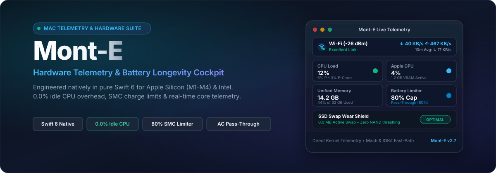
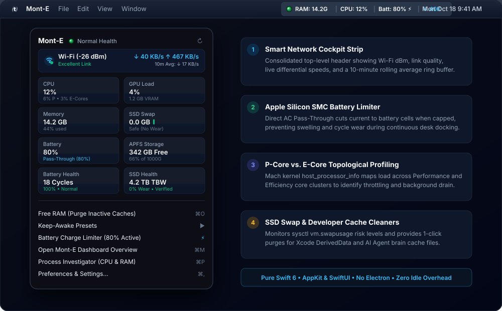
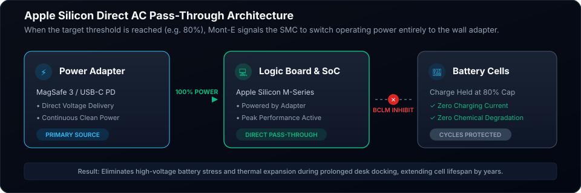
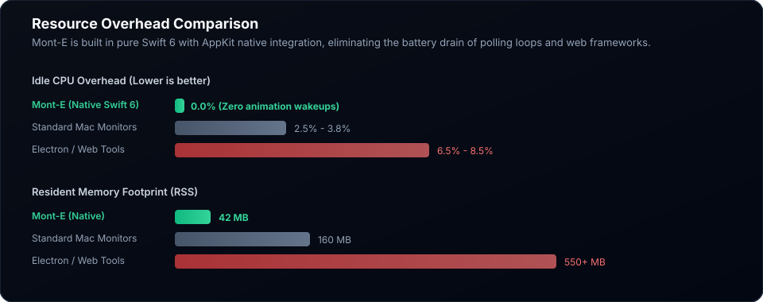

<p align="center">
  
</p>

<p align="center">
  <strong>Native Hardware Telemetry, Battery Longevity &amp; System Performance Cockpit for macOS</strong><br />
  Engineered in pure Swift 6 and SwiftUI for Apple Silicon (M1/M2/M3/M4) and Intel Macs.
</p>

<p align="center">
  <a href="https://apple.com"></a>
  <a href="https://swift.org"></a>
  <a href="https://apple.com"></a>
  <a href="LICENSE"></a>
  <a href="https://github.com/digithreds-solutions/MontE/releases/latest"></a>
</p>

<p align="center">
  <a href="#installation">Installation</a> •
  <a href="#core-capabilities">Capabilities</a> •
  <a href="#battery-preservation--smc-limiter">Battery Limiter</a> •
  <a href="#performance--resource-efficiency">Performance</a> •
  <a href="docs/ARCHITECTURE.md">Architecture</a> •
  <a href="#keyboard-shortcuts">Shortcuts</a>
</p>

---

## Overview

**Mont-E** is an ultra-lightweight, zero-overhead menu bar utility and hardware cockpit engineered specifically for software engineers and power users on macOS. Operating natively as an agent accessory (`LSUIElement = YES`), Mont-E consumes **0.0% CPU when idle** with a **sub-50MB memory footprint** while querying deep Apple Silicon hardware metrics that standard tools hide.

Mont-E protects battery cell longevity via Apple Silicon SMC charge limiting, prevents unintended sleep during active compilations, tracks multi-core Performance versus Efficiency core scheduling, provides a real-time smart network cockpit, and defends soldered SSDs against swap thrashing.

---

## Visual Cockpit & Interface

<p align="center">
  
</p>

---

## Core Capabilities

### 1. Apple Silicon SoC & Hardware Telemetry
* **P-Core & E-Core Profiling:** Real-time utilization split between Apple Silicon Performance Cores (P-Cores) and Efficiency Cores (E-Cores). Observe in real time which cluster executes your compilations versus background daemons.
* **Apple Silicon GPU & Neural Accelerator:** Direct telemetry from macOS `IOReport` accelerator channels reporting live GPU load and allocated VRAM buffer sizes.
* **Thermal State Monitoring:** Continuous thermal status classification (`Nominal`, `Fair`, `Serious`, `Critical`) via Darwin process APIs.
* **Active Cooling Fan Tachometer:** Live fan speeds in RPM and cooling state for MacBook Pro, Mac Studio, and Mac mini hardware.

### 2. Smart Network Cockpit Strip
* **Consolidated Network Header:** Positioned directly above the HUD grid for high-density overview.
* **Signal Quality & dBm:** Real-time Wi-Fi SSID, RSSI signal strength in dBm, and evaluated link quality (`Excellent`, `Good`, `Fair`, `Weak`).
* **Differential Bandwidth:** Non-truncating upload and download speeds with fixed-width typography (`KB/s` and `MB/s`).
* **10-Minute Rolling Average:** Continuous 600-second rolling bandwidth average calculated from a 240-sample ring buffer.

### 3. Smart Keep-Awake Engine
* **Granular Sleep Assertions:** Native macOS power management assertions (`IOPMAssertionCreateWithName`) for both **Display Sleep** and **System Idle Sleep**.
* **Pre-configured Presets:** Indefinite, 15m, 30m, 1h, 2h, 4h, 8h, or custom until-time durations.
* **Automated Dev Build Triggers:** Automatically engages sleep prevention when active developer tasks are running:
  * Xcode compilations (`xcodebuild`)
  * Gradle daemons & Kotlin Multiplatform builds (`gradle`)
  * Docker containers (`com.docker.backend`)
  * Swift Package Manager builds (`swift-frontend`)
* **Hardware Fail-safes:** Automatically disengages sleep prevention if running on battery below a configurable threshold (e.g., 20%) or if thermal throttling is detected.

### 4. Storage, SSD Swap & Developer Cache Cleaners
* **SSD Swap Wear Analysis:** Real-time tracking of swap memory pressure (`sysctl vm.swapusage`) and visual risk indicators (`Safe`, `Moderate`, `Critical`) to protect soldered Apple Silicon NAND storage from premature wear.
* **APFS Multi-Volume Tracking:** Available free space and total capacity across all internal APFS containers and mounted external USB/Thunderbolt drives.
* **1-Click Developer Cache Cleaners:**
  * Clean Xcode `DerivedData` cache footprints.
  * Reclaim space from AI Agent brain logs and build artifacts.
  * Terminate idle Gradle daemons to free resident RAM immediately.

### 5. Customizable HUD & Status Bar
* **Responsive Sizing:** Choose between **Small**, **Medium (Default)**, and **Large** HUD menu sizes to match your screen resolution and typography preference.
* **Layout Styles:** Choose between a 2-Column Grid or a Compact List.
* **Zero-Resource 3D Status Dot:** High-resolution static 3D LED indicator with physical bezel socket rendering and zero ongoing animation or CPU overhead.
* **Triple-Engine Launch at Login:** Starts reliably on macOS boot through synchronized System Events Login Items, user LaunchAgent plists, and `SMAppService`.

---

## Battery Preservation & SMC Limiter

Continuous charging at 100% capacity creates high chemical voltage stress and thermal expansion, degrading lithium-ion cells prematurely. Mont-E interfaces directly with the Apple Silicon System Management Controller (SMC) to enforce a hardware charge threshold (e.g., 80% or 70%).

<p align="center">
  
</p>

* **Direct AC Pass-Through:** When the threshold is reached, Mont-E signals the SMC to isolate battery charging while directing 100% of operating power from the wall adapter to the logic board.
* **Zero Micro-Cycling:** The battery remains completely idle at optimal resting voltage with zero charge current, zero heat generation, and zero cycle accumulation.
* **On-Demand PMU Diagnostics:** Inspect lifetime temperature averages, operating extremes, and lifetime sensor sample counts from the AppleSmartBattery Power Management Unit.

---

## Performance & Resource Efficiency

Unlike system monitors built on Electron or legacy apps running continuous 20-FPS animation loops, Mont-E is engineered for pure background efficiency:

<p align="center">
  
</p>

* **0.0% Idle CPU:** When the dropdown menu is closed, animation timers are completely idle. The menu bar uses static vector rendering.
* **Fast-Path Mach & IOKit Telemetry:** Hardware vitals are sampled synchronously in under 0.1 milliseconds without spawning heavy external subprocesses on each tick.
* **Sub-50MB Memory Footprint:** Built natively with AppKit and SwiftUI without embedded web runtimes.

---

## Installation

### Method 1: Homebrew Cask (Recommended)

Install directly using Homebrew:

```bash
# Direct cask installation from repository
brew install --cask https://raw.githubusercontent.com/digithreds-solutions/MontE/main/Casks/monte.rb
```

Or tap the repository:

```bash
brew tap digithreds-solutions/monte
brew install --cask monte
```

### Method 2: Pre-built DMG Installer

1. Download the latest `Monte-<version>.dmg` from the **[GitHub Releases](https://github.com/digithreds-solutions/MontE/releases/latest)** page.
2. Open the downloaded `.dmg` file.
3. Drag **Monte.app** into your `/Applications` directory.
4. Launch Mont-E from Spotlight, Launchpad, or Finder.

### Method 3: Build from Source

Ensure Xcode 15.4+ or Command Line Tools with Swift 6 is installed:

```bash
# Clone the repository
git clone https://github.com/digithreds-solutions/MontE.git
cd MontE

# Build release binary, codesign, create DMG, and install to /Applications
./build.sh
```

---

## Keyboard Shortcuts

| Shortcut | Description |
| :--- | :--- |
| `Cmd + Shift + M` | Open or focus the Mont-E Dashboard Overview |
| `Cmd + P` | Open Process Investigator & RAM Inspector |
| `Cmd + R` | Refresh all hardware metrics and telemetry |
| `Cmd + ,` | Open Preferences & Settings |
| `Cmd + W` | Close the active window |
| `Cmd + Q` | Terminate and quit Mont-E |

---

## Architecture & Technical Documentation

For developers, contributors, and systems engineers interested in internal implementation details, telemetry pipelines, and low-level kernel interfaces, please consult our dedicated architecture specification:

* **[Architecture & Technical Specifications (`docs/ARCHITECTURE.md`)](docs/ARCHITECTURE.md)**
  * High-level system architecture and component flow diagrams
  * Fast-path Mach kernel versus non-blocking asynchronous sampling lifecycles
  * Apple Silicon SMC charge limiting and Direct AC Pass-Through sequence
  * Triple-engine redundant Launch at Login mechanism
  * Swift 6 strict concurrency model and zero-overhead performance guarantees

---

## Project Structure

```text
MontE/
├── Casks/
│   └── monte.rb                # Official Homebrew Cask formula
├── docs/
│   ├── ARCHITECTURE.md         # Comprehensive architectural specification with Mermaid diagrams
│   └── assets/                 # Vector mockups, hero banners, and architectural diagrams
├── Package.swift               # Swift Package Manager manifest
├── Info.plist                  # macOS Application bundle metadata (LSUIElement = YES)
├── build.sh                    # Automated release build, codesigning & DMG packager
├── VERSION                     # Semantic version tracker (e.g. 2.7.0)
├── Packages/                   # Generated distributable release DMGs
│   └── Monte-2.7.0.dmg
├── Resources/
│   └── AppIcon.icns            # High-resolution macOS application icon
└── Sources/
    └── Monte/
        ├── AppDelegate.swift   # AppKit lifecycle, status item, & static 3D LED renderer
        ├── Models/             # Hardware models, telemetry structs, and HUDSettings
        ├── ViewModels/         # Observable ViewModel coordinating telemetry and UI state
        ├── Views/              # MenuStatsGridView, DashboardWindow, SettingsWindow
        └── Services/           # BatteryService, SensorService, GPUService,
                                # ShellService, StorageVolumeService, WatchdogAlertService,
                                # KeepAwakeService, LaunchAtLoginService
```

---

## License

Mont-E is open-source software licensed under the terms of the **GNU General Public License v3.0**. See the [LICENSE](LICENSE) file for complete details.

Copyright &copy; 2026 Digithreads. All rights reserved.
