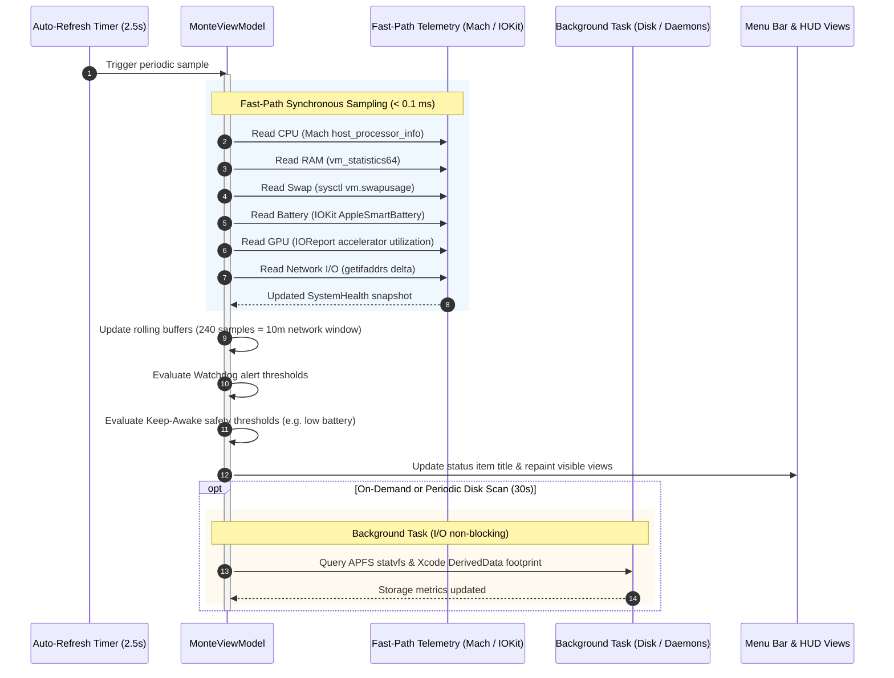
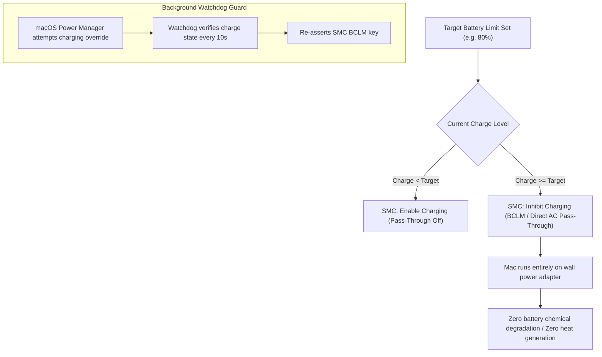
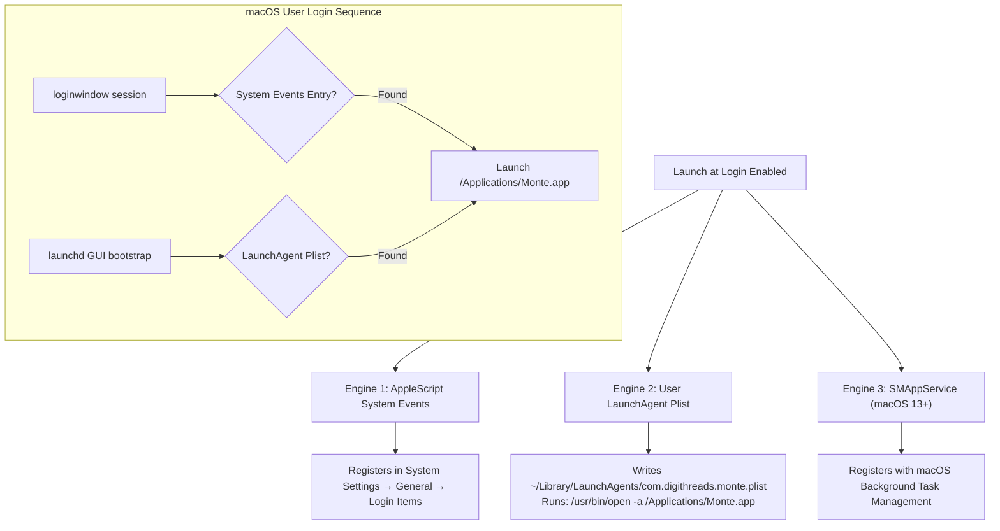

# Mont-E Architecture & Technical Specifications

This document details the architectural design, telemetry pipelines, hardware interaction protocols, and concurrency model of **Mont-E**.

Mont-E is engineered from the ground up in pure **Swift 6** as a high-performance, resident macOS menu bar utility (`LSUIElement = YES`). It operates with near-zero idle resource utilization (0.0% CPU at idle, sub-50MB RSS memory footprint) while querying deep Apple Silicon hardware metrics that standard user-space applications cannot access.

---

## 1. High-Level System Architecture

Mont-E employs a clean, layered architecture separating user interface presentation, observable domain state, specialized hardware drivers, and low-level Darwin/Mach kernel interfaces.

```mermaid
graph TD
    subgraph UI ["User Interface Layer (SwiftUI + AppKit)"]
        MenuBarItem["NSStatusItem (Menu Bar)"]
        DropdownHUD["MenuStatsGridView (Custom NSMenuItem)"]
        Dashboard["DashboardWindow (Multi-Tab Telemetry Cockpit)"]
        Settings["SettingsWindow (Preferences & Hardware Controls)"]
        ProcessInvestigator["ProcessInvestigatorSheet (Memory & Process Inspector)"]
    end

    subgraph State ["State Coordination Layer"]
        VM["MonteViewModel (@Observable, @MainActor)"]
        KeepAwake["KeepAwakeService (Sleep Assertion Manager)"]
        SettingsStore["MonteSettingsStore (Persistent Configuration)"]
    end

    subgraph CoreServices ["Hardware & Telemetry Services"]
        StatsService["SystemStatsService (CPU, RAM, Swap, Disk)"]
        BatterySvc["BatteryService (IOKit AppleSmartBattery & SMC)"]
        GPUSvc["GPUService (IOReport / IOAccelerator)"]
        NetDiag["NetworkDiagnosticsService (CoreWLAN & Interface I/O)"]
        SensorSvc["SensorService (Fan RPM & Thermals)"]
        VolSvc["StorageVolumeService (APFS Volumes & External Drives)"]
        LoginSvc["LaunchAtLoginService (Triple-Engine Launch Manager)"]
        WatchdogSvc["WatchdogAlertService (Threshold Monitoring)"]
    end

    subgraph DarwinKernel ["macOS Subsystems & Kernel APIs"]
        Mach["Mach Kernel (host_processor_info, mach_vm_pressure)"]
        IOKit["IOKit / AppleSilicon SMC (AppleSmartBattery, PMU, SMC Keys)"]
        DarwinLibProc["Darwin libproc & sysctl (proc_pidinfo, vm.swapusage, statvfs)"]
        CoreWLAN["CoreWLAN Framework (CWWiFiClient, RSSI, SNR, Channel)"]
        IOBluetooth["IOBluetooth (CoreBluetooth & Peripheral Battery Levels)"]
        IOPM["IOPMAssertion (Power Management Assertions)"]
    end

    MenuBarItem --> VM
    DropdownHUD --> VM
    Dashboard --> VM
    Settings --> VM
    ProcessInvestigator --> VM

    VM --> KeepAwake
    VM --> SettingsStore
    VM --> StatsService
    VM --> BatterySvc
    VM --> GPUSvc
    VM --> NetDiag
    VM --> SensorSvc
    VM --> VolSvc
    VM --> WatchdogSvc
    Settings --> LoginSvc

    StatsService --> Mach
    StatsService --> DarwinLibProc
    BatterySvc --> IOKit
    GPUSvc --> IOKit
    SensorSvc --> IOKit
    VolSvc --> DarwinLibProc
    NetDiag --> CoreWLAN
    SensorSvc --> IOBluetooth
    KeepAwake --> IOPM
```

---

## 2. Telemetry Polling & Execution Lifecycle

Mont-E differentiates between **ultra-fast hardware polling** and **expensive background tasks** to ensure responsiveness without waking CPU cores unnecessarily.

---

## 3. Battery Preservation & Apple Silicon SMC Architecture

Mont-E provides hardware-level charge threshold management and direct pass-through capabilities for Apple Silicon MacBooks (M1 through M4).

### Technical Details:
* **Charge Inhibit Mechanism:** Mont-E interfaces with the Apple Silicon System Management Controller (SMC) to set the battery charge limit register (`BCLM`). When reached, power circuitry cuts current to the battery cells while supplying direct operating voltage to the logic board via **Direct AC Pass-Through**.
* **On-Demand Lifetime Thermal Diagnostics:** Deep queries to the `AppleSmartBattery` Power Management Unit (PMU) for lifetime temperature averages, operating extremes, operating hours, and sensor telemetry samples run exclusively on-demand when the user views the Battery Tab, avoiding continuous IOKit polling.

---

## 4. Triple-Engine Launch at Login Architecture

Because macOS Ventura, Sonoma, and Sequoia enforce strict Background Task Management (BTM) rules on ad-hoc signed open-source applications, Mont-E implements a **triple-engine redundant launch architecture**:

* **Engine 1 (System Events Login Item):** Creates a standard persistent login item that appears natively in `System Settings → General → Login Items`.
* **Engine 2 (User LaunchAgent):** Deploys a LaunchAgent to `~/Library/LaunchAgents/com.digithreads.monte.plist` invoking `/usr/bin/open -a /Applications/Monte.app`. Unlike `SMAppService`, user LaunchAgents are unconditionally bootstrapped by `launchd` on user login regardless of code signing status.
* **Engine 3 (SMAppService):** Concurrently registered for seamless macOS 13+ ServiceManagement compatibility.

---

## 5. Subsystem Implementations

### 5.1 Apple Silicon CPU & Core Cluster Profiling
* Utilizes Mach kernel `host_processor_info` with `PROCESSOR_CPU_LOAD_INFO` flavor.
* Queries processor topological information to divide logical CPU cores into **Performance (P) Cores** and **Efficiency (E) Cores**.
* Computes real-time per-cluster averages:
  $$\text{Utilization}_{\text{cluster}} = \frac{\Delta \text{User} + \Delta \text{System} + \Delta \text{Nice}}{\Delta \text{User} + \Delta \text{System} + \Delta \text{Nice} + \Delta \text{Idle}}$$

### 5.2 GPU & Neural Engine Telemetry
* Reads Apple Silicon IOAccelerator statistics via the private `IOReport` framework channels (`GPU Performance Statistics`).
* Extracts active device utilization percentage and allocated VRAM buffer sizes without polling third-party tools.

### 5.3 Smart Network Cockpit & Bandwidth Calculation
* **Interface Bandwidth:** Scans network interfaces via Darwin `getifaddrs` to compute differential byte counters ($\Delta \text{bytes} / \Delta t$) converted to `KB/s` or `MB/s`.
* **10-Minute Rolling Average:** Maintains a FIFO ring buffer of 240 samples ($240 \times 2.5\text{s} = 600\text{s}$).
* **Wi-Fi Diagnostics:** Uses `CoreWLAN` (`CWWiFiClient`) to extract RSSI (dBm), noise floor, Wi-Fi channel, frequency band (2.4 GHz, 5 GHz, 6 GHz), and evaluates link quality:
  * $\text{RSSI} \ge -65 \text{ dBm}$: Strong / Excellent
  * $-78 \text{ dBm} \le \text{RSSI} < -65 \text{ dBm}$: Fair
  * $\text{RSSI} < -78 \text{ dBm}$: Weak

### 5.4 Sleep Prevention (Keep-Awake Engine)
* Wraps the native Darwin Power Management assertion API (`IOPMAssertionCreateWithName`).
* Generates either `kIOPMAssertionTypePreventUserIdleSystemSleep` or `kIOPMAssertionTypePreventUserIdleDisplaySleep`.
* Automated dev triggers monitor running processes via `proc_listpids` and `proc_pidinfo` to detect active compilations (`xcodebuild`, `gradle`, `swift-frontend`, `docker`) and engage assertions automatically.

---

## 6. Concurrency & Performance Guarantees

* **Swift 6 Strict Concurrency:** The entire codebase is compiled with Swift 6 mode enabled. All UI elements, views, and view model instances are bound to `@MainActor`.
* **Zero Timer Wakeups When Idle:** The menu bar status dot uses static vector rendering ([NSImage.threeDimensionalLedDot](file:///Users/arunelectra/Project/Tech/DevTools/MontE/Sources/Monte/AppDelegate.swift#L604)) with no continuous animation timers. When the dropdown menu is closed, Mont-E consumes 0.0% CPU.
* **Deterministic Memory Footprint:** Telemetry buffers use pre-allocated static capacities (e.g. 240 samples for network history, 30 samples for CPU/GPU sparklines), preventing memory fragmentation.
